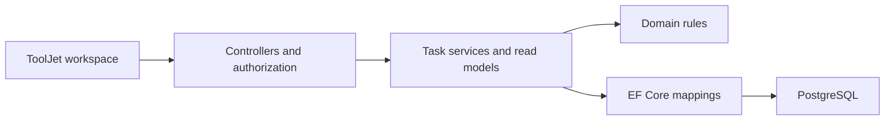

# Backend CRM: education operations

ASP.NET Core, EF Core and PostgreSQL backend for clients, purchases, learning
groups, product access and internal team requests. ToolJet is the UI consumer.

This public repository is a source-review snapshot of FFA, prepared for a
portfolio walkthrough. It includes the current source and regression scenarios,
not the private repository history, server configuration or client data.
No build, test run or deployment was performed while preparing this snapshot.

## Review the code

Latest [review corrections](docs/review-race-fixes.md): session security versions,
concurrent learning writes, pending access cancellation and bounded client cards
with paginated history. Regression sources are included but were not executed.

Start with the [review guide](docs/portfolio-review-guide.md),
[business rules](docs/business-rules.md) and [workspace API map](docs/workspace-api-map.md).
The map distinguishes implemented features from proposed contracts.

For a source-only walkthrough, read the [client module](docs/client-module-architecture.md)
and [purchase-to-achievement showcase](docs/showcase/client-lifecycle.md).
Neither requires running the backend or a database.

For the current review baseline, see the [completion checklist](docs/project-review-checklist.md),
[API conventions](docs/api-conventions.md), [relationship map](docs/domain-map.md)
and [role matrix](docs/role-matrix.md). These are source-review artifacts, not a
claim of successful deployment or executed verification.

Representative code:

- [Client HTTP adapter](src/backend/Controllers/Clients/ClientsController.cs):
  routing and response mapping without EF queries or domain mutations.
- [Client workspace](src/backend/Features/Clients/Workspace): separate database
  reads and in-memory projections for the full card.
- [Client commands](src/backend/Features/Clients/Commands): validated client/email
  operations with authenticated audit and financial write checks.

- [Enrollment](src/backend/Domain/LearningStructure/Enrollment.cs): purchased
  product/package compatibility, transfers and lifecycle rules.
- [EnrollmentService](src/backend/Features/Learning/EnrollmentService.cs): use
  cases, bounded reads and atomic audit writes.
- [LearningWorkspaceController](src/backend/Controllers/Learning/LearningWorkspaceController.cs):
  HTTP adapter with onboarding/admin authorization.
- [EnrollmentTests](tests/Backend.Tests/EnrollmentTests.cs): rejected assignments,
  frozen transfers and terminal states.
- [Client profile](src/backend/Features/Clients/Profile): a symmetric form contract
  and a focused save operation.
- [Client contacts](src/backend/Features/Clients/Contacts): block replacement,
  normalized input and protection against removing the last contact method.
- [Client purchases](src/backend/Features/Clients/Purchases): purchase-scoped
  read models with independently paginated access and learning sections.
- [Internal requests](src/backend/Features/Applications): replies, status
  processing and request-linked profile changes with atomic audit.
- [Backend security](src/backend/Auth/BackendSecurity.cs): live session checks,
  database-derived permissions and JWT validation.
- [Security HTTP tests](tests/Backend.Tests/SecurityHttpTests.cs): authorization,
  financial isolation, session revocation and validation through real controllers.
- [Sales ingress](src/backend/Features/Integrations/Sales): Person/Deal matching,
  idempotent event receipts, immutable purchases and deduplicated confirmed payments.
  See the [contract and source-only review notes](docs/sales-ingress-api.md).
- [EF relationships](docs/ef-relationships.md): explicit foreign keys and inverse
  navigations, enrollment-preserving deletion policy and guarded schema cleanup.
- [Bot messaging](docs/bot-messaging.md): FFA-side transactional outbox, RabbitMQ
  publisher confirms, result inbox, idempotent access confirmation and correlated
  request logs. Disabled by default; the external Discord worker is a separate
  contract boundary, not included or claimed as connected.

## Architecture

The application is a modular monolith with one PostgreSQL database. New code is
organized by task under Features. Controllers adapt HTTP, application services
orchestrate scenarios, domain methods enforce rules, and Infrastructure contains
EF mappings. Resource HTTP adapters delegate to module management services;
task-focused workspaces retain their dedicated feature services.

HTTP entry points are grouped by module under [Controllers](src/backend/Controllers/README.md).
Resource DTOs, queries, commands and validators are grouped under Features,
not nested in controller types. Auth and Health remain infrastructure adapters.



Payment, subscription and learning dates have different meanings. A payment
triggers entitlement creation; actual access grant starts its duration; cohort
dates describe learning. This lifecycle is implemented for automatic
subscriptions; see [subscription lifecycle](docs/subscription-lifecycle.md) for
catalog conventions and legacy compatibility.

## Build and test

Prerequisite: .NET 9 SDK.

```sh
dotnet build src/backend/backend.csproj
dotnet test tests/Backend.Tests/Backend.Tests.csproj
```

The fast suite includes domain tests and HTTP tests through TestServer with EF
InMemory. It does not establish PostgreSQL query correctness or deployed ToolJet
behavior. The included GitHub workflow targets this fast suite and is manual-only;
creating or pushing this snapshot does not run it. The integration project is
separate, starts infrastructure if invoked and is not required for source review.
The client/module refactors and their added test examples were not compiled or executed;
earlier verification results must not be treated as verification of this change.

## Run locally

Provide PostgreSQL and configure these environment variables (or .NET user
secrets). Use your own credentials; never commit real values.

```text
ConnectionStrings__DefaultConnection=Host=localhost;Port=5432;Database=ffa;Username=<user>;Password=<password>
Jwt__SigningKey=<cryptographically-random-secret-at-least-32-bytes>
Jwt__Issuer=ffa-backend
Jwt__Audience=ffa-tooljet
ASPNETCORE_ENVIRONMENT=Development
```

Run from the backend directory so appsettings and optional local .env resolve
consistently:

```sh
cd src/backend
dotnet run -- --migrate
dotnet run
```

Use the listening URL printed by ASP.NET Core. Swagger is at /swagger in
Development; /health is public. Authenticate through /auth/login and supply
Authorization: Bearer <accessToken>. See [request examples](src/backend/backend.http).
Initial Admin provisioning uses a local operator command, not public HTTP.
See [security and ToolJet migration](docs/backend-security.md).
New /learning mutation routes require OnBoarding or Admin.

## Deployment boundary

Private deployment workflows, environment files and production infrastructure are
intentionally excluded. The Dockerfile under src/backend is retained as source;
its build context is src. No container build or deployment is claimed. ToolJet
screens and external Discord workers are separate consumers, not included apps.

## Current scope and gaps

Implemented task features: profile editing, contact editing, purchase browsing
and the learning assignment workspace.
Existing API areas include clients, orders/payments, products/packages,
subscriptions, applications, cases, roadmaps, users and JWT sessions.

Financial permissions, private client reads and revocable JWT sessions are
implemented with HTTP tests using TestServer and EF InMemory.
Remaining work includes executing the supplied PostgreSQL integration scenarios,
reviewing real query plans and completing external access-provider adapters. AccessRevoked records
a learning state; it does not revoke a Discord or platform role remotely.
See the API map for exact semantics and limitations.
