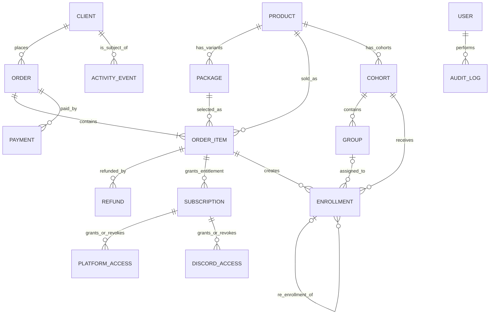

# ADR-001: связь продажи, доступа и обучения через OrderItem

> Historical design proposal, not a description of the current implementation
> or confirmed commercial policies. For current behavior read business-rules.md,
> project-review-checklist.md and review-race-fixes.md in the parent docs folder.

**Статус:** proposed — обновлён утверждёнными бизнес-решениями; до миграции остаются открытые вопросы.  
**Дата:** 2026-08-10.  
**Решение:** `Enrollment` и `Subscription` принадлежат конкретному `OrderItem`, а не `Order`.

## Контекст и проблема

Сейчас `Enrollment` содержит `OrderId`. Заказ может состоять из нескольких `OrderItem`, поэтому из существующей записи нельзя достоверно восстановить, за какой продукт и пакет клиент зачислен. Это делает неоднозначными поток, группа, условия доступа и последствия частичного возврата.

`Package` — вариант доступа одного продукта: он определяет срок, Discord-доступ, уровень курса и поддержки. Условия в каталоге изменяемы во времени, а факт покупки и выданные по нему права должны оставаться исторически объяснимыми.

В FFA поступают только покупки с уже подтверждённой оплатой. Проверка оплаты, статусы платёжного провайдера и решение о том, можно ли выдать entitlement по payment, находятся вне scope этого ADR и backend FFA получает только подтверждённый факт покупки.

## Принятое решение

1. Единица коммерческого обязательства — **OrderItem**. Он является причиной подписки, доступов и зачисления.
2. `Enrollment.OrderItemId` — обязательный FK после завершения backfill. `Enrollment.OrderId` удаляется из write-модели после периода совместимости; в read-model он всегда вычисляется как `Enrollment.OrderItem.OrderId`.
3. `Subscription.OrderItemId` остаётся обязательным. `Subscription.ClientId` и `ProductId` допустимы как денормализованные FK для быстрых запросов, но валидируются относительно `OrderItem`, а не вводятся клиентом.
4. `PlatformAccess` и `DiscordAccess` принадлежат `Subscription`; каждая запись доступа является фактом выдачи/отзыва, а не свойством клиента или enrollment.
5. `Cohort` принадлежит одному `Product`; `Group` — одному `Cohort`; enrollment можно назначить только в cohort/group продукта купленного order item.
6. Для обучающего продукта `OrderItem` означает один продукт и одно место: `Quantity = 1` обязательно. `quantity > 1` запрещено на уровне domain validation и БД.
7. `Group.PackageId` обязателен. Он должен принадлежать продукту cohort и **точно совпадать** с `Enrollment.OrderItem.PackageId`.
8. Возврат создаёт `Refund` для конкретного OrderItem и выполняется только ролью `TroubleShooter`. Он меняет только подписки, доступы и enrollments этой позиции, не отменяя соседние позиции заказа.
9. Ручной доступ оформляется отдельным бесплатным OrderItem (`price = 0`, `quantity = 1`) с причиной выдачи и audit event; прямое создание Subscription/Access без OrderItem запрещено.
10. Повторное обучение после `Frozen` создаёт **новый** Enrollment в новом cohort с `reEnrollmentOfEnrollmentId` на старый Enrollment. Старый Enrollment не переносится и остаётся историческим фактом.

## Словарь и владельцы фактов

| Сущность | Назначение / источник истины | Не является |
|---|---|---|
| Client | Личность покупателя/ученика и контакты | Покупкой, подпиской или зачислением. |
| Product | Стабильный продаваемый продукт верхнего уровня | Условиями конкретной покупки. |
| Package | Вариант продукта и текущие правила доступа | Историческим доказательством того, что было продано. |
| Order | Коммерческий контейнер покупки клиента | Единицей доступа или обучения. |
| OrderItem | Конкретная позиция: product + package + цена + количество + snapshot | Платежом; один payment может покрывать несколько позиций. |
| Payment | Денежная попытка/факт оплаты заказа | Доступом или возвратом. |
| Refund | Денежный возврат, привязанный к конкретному OrderItem и созданный TroubleShooter | Удалением order item. |
| Subscription | Право пользования, возникшее из OrderItem | Фактом технической выдачи доступа. |
| PlatformAccess / DiscordAccess | Технический факт grant/revoke в конкретной системе | Сроком подписки или enrollment. |
| Cohort | Поток одного продукта | Пакетом или группой. |
| Group | Группа внутри одного cohort | Самостоятельным потоком. |
| Enrollment | Факт зачисления по конкретному OrderItem в обучение | Платежом или platform access. |
| AuditLog / ActivityEvent | Неизменяемая история actor/action/time | Источником текущего состояния. |

## Целевая ER-модель

### Кардинальности и инварианты

| Связь | Кардинальность | Инвариант |
|---|---:|---|
| Client → Order | 1:N | Заказ принадлежит ровно одному client. |
| Order → OrderItem | 1:N | Нельзя создать заказ без позиции при переходе в оплатный статус. |
| OrderItem → Product + Package | N:1 + N:1 | `Package.ProductId == OrderItem.ProductId`; для обучающего item `Quantity == 1`. Проверяется в доменной команде и БД/триггере, если FK не может выразить правило. |
| Order → Payment | 1:N | Payment относится к заказу, allocation на item — отдельный факт при необходимости. |
| OrderItem → Refund | 1:N | Каждый Refund относится к одному item и создан TroubleShooter; сумма confirmed refunds не превышает amount item. |
| OrderItem → Subscription | 1:N | Каждая подписка имеет один исходный item; несколько возможны только для подтверждённых entitlement-компонентов. |
| Subscription → Access | 1:N | Access неизменно хранит subscription id, grant/revoke time и external identifier. |
| Product → Cohort | 1:N | Cohort обслуживает ровно один product. |
| Cohort → Group | 1:N | Group обязана иметь cohort и package; `Group.PackageId` принадлежит product cohort. |
| OrderItem → Enrollment | 1:N | Enrollment всегда имеет один order item; максимум один active enrollment на item. Повторное обучение создаёт новый enrollment, ссылающийся на старый через `reEnrollmentOfEnrollmentId`. |
| Enrollment → Cohort → Group | N:1, N:0..1 | При group assignment `Group.CohortId == Enrollment.CohortId`; `Cohort.ProductId == OrderItem.ProductId`; `Group.PackageId == OrderItem.PackageId`. |

Для обучающих продуктов `Quantity > 1` запрещено. Поэтому отдельный `OrderItemEntitlement` для разбиения мест не требуется: один обучающий OrderItem всегда объясняет одну подписку и одно место; повторное обучение создаёт новый Enrollment, а не копирует или переносит старый.

## Snapshot и историчность каталога

### Решение

Package **можно редактировать как текущую витрину**, но проданная позиция никогда не должна зависеть от его текущих полей. При создании `OrderItem` backend формирует неизменяемый `packageSnapshot` (JSONB или нормализованные immutable columns) и вычисляет права на его основе. Изменение package не меняет существующие subscription/enrollment/access.

В snapshot обязательно сохранять:

| Поле | Причина |
|---|---|
| `productId`, `productCode`, `productName` | Идентификация проданного продукта после rename/archive. |
| `packageId`, `packageCode`, `packageName` | Идентификация выбранного варианта. |
| `catalogVersion` | Связь с опубликованной редакцией каталога. |
| `durationDays` | Расчёт contract subscription end. |
| `discordAccess`, `discordDays`, Discord role/template | Право на Discord и срок. |
| `platformAccess`/platform entitlement | Право на обучающую платформу. |
| `courseLevel`, `supportLevel` | Обещанный уровень курса/поддержки. |
| `price`, `currency`, tax/discount allocation | Коммерческое доказательство покупки. |
| `refundPolicyVersion` | Правило, действовавшее при покупке. |
| `grantReason` и `grantType` | Для бесплатного ручного OrderItem: причина и признак `manual`; связанный audit event хранится отдельно. |

После первой продажи нельзя изменять semantic fields существующей опубликованной версии package (`durationDays`, access, level, support, refund policy). Рекомендуемый механизм — `PackageVersion`: package сохраняет stable identity/code, а новая published version получает новый `catalogVersion`; заказ фиксирует version и snapshot. Разрешены без version только editorial name/description, если они не меняют обещание клиенту. Для более простого первого этапа допускается immutable snapshot + запрет редактирования semantic fields проданного package; полноценное версионирование — следующий этап.

## Статусы, переходы и полномочия

### OrderItem и возврат

| Состояние | Разрешённые переходы | Кто | Эффект |
|---|---|---|---|
| ConfirmedPurchase | PartiallyRefunded, Refunded, Closed | Системная загрузка подтверждённых покупок / TroubleShooter для закрытия | FFA получает покупку уже оплаченной; payment verification не выполняет. |
| PartiallyRefunded | Refunded, Closed | TroubleShooter | Обрабатывается только конкретный OrderItem; правила частичного возврата требуют отдельного решения. |
| Refunded/Closed | нет; correction отдельной командой | TroubleShooter | Terminal, историю не стирать. |

`Refund` — отдельная неизменяемая запись с `orderItemId`, суммой, валютой, причиной, external reference, `requestedAt/confirmedAt`, actor (`TroubleShooter`). Текущий общий Order status — агрегированная проекция item/refund, не замена item-level refund state.

### Subscription, access и enrollment

| Сущность | Переходы | Кто | Правило/эффект |
|---|---|---|---|
| Subscription | Pending → Active → Suspended → Active; Active/Suspended → Cancelled; Active → Expired/Graduated | TroubleShooter — cancel по возврату; system — expire; Curator/Onboarding — suspend только с reason | Создаётся из подтверждённого или бесплатного manual OrderItem snapshot. Cancelled/Expired terminal. |
| Access grant | Pending → Granted → Revoked/Expired | Onboarding/Curator; TroubleShooter for refund revocation; system expiration | Grant хранит `grantedAt`; revoke никогда не удаляет grant. Active subscription — prerequisite. |
| Enrollment | Pending → Assigned → Active; Active → Frozen|Dropped|Graduated; Pending/Assigned → Dropped; Frozen → Dropped | Onboarding/Curator; TroubleShooter — drop по возврату | Assignment требует compatible cohort и обязательного package match. Для повторного обучения после Frozen создаётся новый Enrollment с `reEnrollmentOfEnrollmentId`; старый не реактивируется. |
| Cohort | Planned → Active → Completed → Archived | Curator/Admin | Archived terminal; нельзя назначать enrollment в Completed/Archived. |

Эффект confirmed refund:

1. TroubleShooter определяет сумму возврата для **одного** order item и фиксирует причину.
2. При полном возврате отменить/отозвать только subscriptions этого item; завершить активные platform/Discord access с `revokedReason=refund`.
3. Активный enrollment этого item перевести в `Dropped` с `reason=refund` (не удалить). Момент прекращения доступа и обучения выбирается по утверждённому правилу TroubleShooter; до этой даты факт возврата и запланированное прекращение должны быть аудируемы.
4. Другие items, их access и enrollments не изменяются.
5. В одной транзакции записать refund decision, state transitions и ActivityEvent/AuditLog; внешнее отключение Discord/platform выполняется через outbox с идемпотентным key.

## Даты: разные факты

| Факт | Поле | Источник |
|---|---|---|
| Покупка | `purchaseDate` | `Order.CreatedAt` для order item. |
| Оплата | `paidAt` | `Payment.PaidAt`; не равно purchase date. |
| Подписка | `subscriptionStartAt` / `subscriptionEndAt` | Subscription. |
| Техническая выдача | `grantedAt`, `revokedAt` | PlatformAccess/DiscordAccess. |
| Зачисление | `enrollmentDate` | Enrollment.Created/EnrolledAt. |
| Начало/конец обучения | `learningStartAt` / `learningEndAt` | Cohort.StartAt/EndsAt. |
| Возврат | `refundedAt` | Refund. |

## План миграции без breaking changes

### Этап 0 — подготовка и инвентаризация

* Добавить в read-only отчёт `enrollment_id, order_id, candidate_order_item_ids, cohort.product_id, group.package_id, confidence, reason` на `ffa_test`; не менять данные.
* Классифицировать: **A** один order item; **B** несколько, но ровно один совпадает с `Cohort.ProductId`; **C** несколько и совпадений 0/>1; **D** order item отсутствует/данные повреждены; **E** enrollment без cohort (нельзя вывести product).
* Результат этапа — signed-off mapping и число ручных случаев; миграционная валидация отдельно подтверждает, что все новые обучающие items имеют `quantity = 1`.

### Этап 1 — expand schema и dual write

* Добавить nullable `enrollments.order_item_id`, FK на `order_items(id)`, индекс, nullable `order_items.package_snapshot`, таблицу `refunds` и при необходимости outbox. Не удалять `order_id`.
* Новый endpoint/command требует `orderItemId`; server проверяет, что item принадлежит client, имеет `quantity = 1` и совместим с cohort/group по product **и package**. Legacy `orderId` endpoint временно выбирает item **только** если единственный candidate; иначе `422 order_item_required`.
* Новые записи всегда пишут оба поля (`OrderItemId` и legacy `OrderId`, derived from item) до переключения reads.

### Этап 2 — backfill

* A и B связать автоматически, записав `mappingSource=automatic` и основание в audit metadata.
* C/D/E не угадывать: оставить nullable, создать manual reconciliation queue с выбранным item, оператором и timestamp.
* Прогнать reconciliation на `ffa_test`, проверить: каждый mapped item принадлежит enrollment order; cohort product совпадает с item product; group принадлежит cohort и имеет тот же package, что item; counts до/после совпадают.

### Этап 3 — cutover

* Read DTO добавляют `orderItemId`; новый UI/API читает связи через него. Временно возвращать `orderId` как derived compatibility field.
* Запретить создание enrollment без item, добавить database `NOT NULL` **только когда** manual queue пуста, данные валидированы и все writers dual-write.
* Перевести FK/cascade policy: удаление order item запрещено (soft state/refund), чтобы не стереть enrollment/audit.

### Этап 4 — contract cleanup

* После согласованного периода и telemetry zero-usage удалить legacy write path и физическое `Enrollment.OrderId` (либо оставить generated/read-only projection, если это облегчает отчётность).
* Любая миграция сначала применяется к backup-копии `ffa_test`; prod — только после backup, migration rehearsal, reconciliation report и rollback/forward-fix плана.

## Последствия и критерий работы разработчика

* «По какой покупке создано зачисление?» — `Enrollment.OrderItemId → OrderItem → Order`; package snapshot объясняет условия.
* «Почему клиент получил доступ?» — `Access.SubscriptionId → Subscription.OrderItemId → OrderItem`, плюс immutable grant/audit event.
* «Что будет при возврате позиции?» — только её subscriptions/access/enrollments переходят по refund workflow; другие OrderItems неизменны.
* «Можно ли назначить в поток?» — да, только если item активен/не возвращён, имеет `quantity = 1`, `OrderItem.ProductId == Cohort.ProductId`, cohort назначаемого статуса, а group принадлежит этому cohort и `Group.PackageId == OrderItem.PackageId`.

## Открытые вопросы владельцу продукта

1. **Вопрос к TroubleShooter:** при возврате конкретного OrderItem когда прекращаются platform/Discord access и обучение: сразу, в конце текущего периода или в выбранную дату? Нужны ли отдельные правила для chargeback?
2. Допускаются ли partial refunds конкретного OrderItem; если да, какой эффект на единственное место, subscription и доступы?
3. Какие изменения package являются semantic и должны выпускать новую версию? Нужны ли будущие scheduled package versions?
4. Нужна ли детализация платежей по item (`PaymentAllocation`) для частичных платежей/скидок, либо достаточно order-level оплаты в первом релизе?
