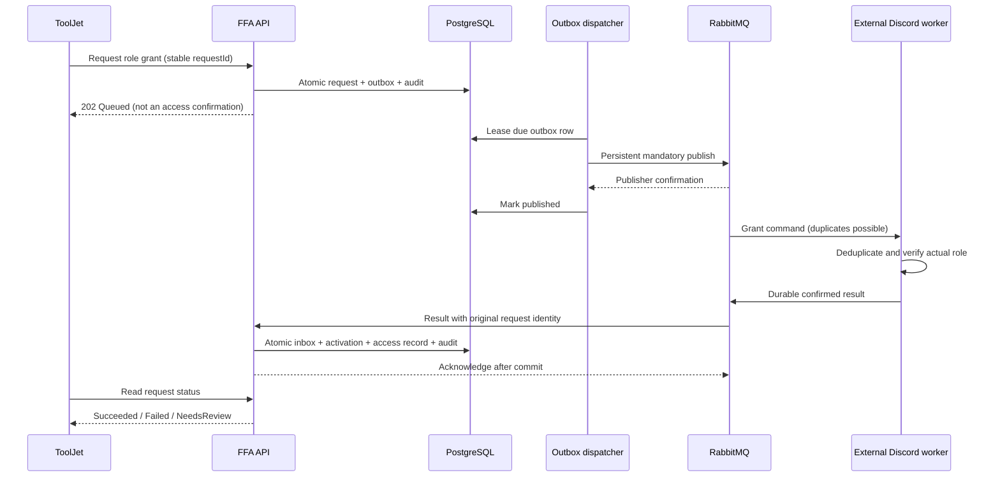

# Bot messaging: Discord access workflow

## Review status

This is an implemented FFA-side source slice, not a verified deployment.
No build, tests, broker, migrations, bots or external role operations were run
for this addition. Messaging is disabled by default. The external worker is a
separate application and is **not included** in this repository; its required
behavior is specified below. An existing HTTP webhook returning 200 is not
accepted as evidence that a Discord role was granted.

Read `DiscordGrantController` -> `DiscordGrantService` -> `OutboxDispatcher`
-> `RabbitBotPublisher` -> `DiscordResultConsumer` -> `DiscordResultHandler`.
`BotMessagingTests` and `BotMessagingBoundaryTests` contain unexecuted behavioral
and boundary examples. EF configurations,
the migration and snapshot describe the three new persistence tables.



## Request a Discord grant

### Endpoint
`/subscriptions/{id}/discord-access-requests`

### Method
`POST` (202 on initial acceptance and idempotent replay; Location points to GET).

### Params
`id`: subscription ULID. Bearer session required; roles `Admin`, `OnBoarding`.
Optional `X-Correlation-Id`: a GUID in 32-character N format. Invalid values
are replaced; the selected ID is returned in the response header.

### Request body
```json
{
  "requestId": "01ARZ3NDEKTSV4RRFFQ69G5FAV",
  "discordUserId": "123456789012345678"
}
```

The UI generates one ULID per intended operation and preserves it for network
retries. A Discord numeric ID is required, not a nickname or email. Guild and
role are resolved by the backend from the purchased package code, never chosen
by the browser. Request size is limited to 16 KiB; unknown fields are rejected.

### Response
```json
{
  "requestId": "01ARZ3NDEKTSV4RRFFQ69G5FAV",
  "subscriptionId": "01ARZ3NDEKTSV4RRFFQ69G5FAW",
  "discordUserId": "123456789012345678",
  "status": "Queued",
  "deliveryStatus": "pending",
  "attempts": 0,
  "errorCode": null,
  "requestedAtUtc": "2026-10-23T12:00:00+00:00",
  "completedAtUtc": null
}
```

`status`: `Queued`, `Succeeded`, `Failed`, `NeedsReview`, `Canceled`.
`deliveryStatus`: `pending`, `published`, `dead_lettered`, `canceled`.
See [pending cancellation and race corrections](review-race-fixes.md) for
`POST /subscriptions/{id}/cancel-pending`, dispatch coordination and late results.
Published means the broker confirmed delivery to a queue, not that a role exists.
In a publisher/DB recovery race, a result can arrive before the published flag
is committed. Business status takes precedence over delivery status in the UI.

### Backend logic
Require an automatically provisioned Discord subscription in `AwaitingAccess`,
a positive duration and a successfully paid order. Resolve and snapshot the
configured target. Save request, outbox and authenticated audit in one database
save. Only one queued grant per subscription is allowed by a unique nullable
key. Replaying the same request/subscription/user returns its existing state;
reusing that ID for different input is a conflict. Concurrent writes can return
409; retry GET or repeat the original request ID after refreshing.

### Validation and errors
- 400 `validation_error`: invalid IDs/body; Discord IDs contain 17-20 digits.
- 401/403: missing/expired session or insufficient role.
- 404 `subscription_not_found`: no such subscription.
- 409 `request_id_conflict`, `discord_grant_pending`, `discord_grant_not_allowed`,
  `paid_order_required`: conflicting operation or ineligible purchase.
- 409 `resource_conflict` / `concurrent_change`: concurrent state change.
- 413: request exceeds the configured body limit.
- 503 `bot_messaging_disabled` / `discord_mapping_missing`: integration is
  disabled or the package target is not configured. No fake success is returned.
- 500 `internal_error`: generic HTTP failure; response contains a trace reference.

### ToolJet integration
Place the action in a purchase/subscription detail panel. Enable it only for an
eligible Discord subscription, require an explicit Discord ID and show a
confirmation. Store the returned requestId, display `Queued`, and poll the GET
below only while the panel is open and status is Queued, e.g. every 3-5 seconds.
Stop polling on terminal state or panel close; use an operational timeout to
show "awaiting confirmation", never invent success. Refresh the client's
products/access sections only after `Succeeded`.

## Read a request

### Endpoint
`/subscriptions/{id}/discord-access-requests/{requestId}`

### Method
`GET`

### Params
Both IDs are ULIDs. The request is scoped to the supplied subscription. Same
session/roles as POST.

### Request body
None.

### Response
200, the same `DiscordGrantView` JSON as above, with current states/timestamps.

### Backend logic
Read the scoped operation and its delivery record. Reading stored history
remains possible even if messaging has subsequently been disabled.

### Validation and errors
400 invalid IDs; 401/403 authentication/role; 404 `discord_request_not_found`;
500 `internal_error`.

### ToolJet integration
Drive loading/success/error badges from status, not HTTP status alone. Present
`NeedsReview` as a manual reconciliation task: a physical role may exist even
though FFA deliberately refused activation.

## Retry exhausted delivery

### Endpoint
`/subscriptions/{id}/discord-access-requests/{requestId}/retry-delivery`

### Method
`POST`

### Params
Both IDs are ULIDs. Same session/roles as above.

### Request body
None.

### Response
200, the same view. A queued, locally exhausted outbox message returns to
`deliveryStatus: "pending"`, attempts 0. Repeating this action is a no-op unless
delivery has exhausted its attempts again.

### Backend logic
Reset only an unpublished dead-lettered outbox entry belonging to a Queued
operation; write an authenticated retry audit. Already-published messages are
not blindly resent. Terminal requests cannot be republished. A worker-reported
Failed operation may be followed by a new request ID after fixing its cause.

### Validation and errors
400 invalid IDs; 401/403; 404 `discord_request_not_found`;
409 `discord_request_completed` or concurrency conflict; 503 integration disabled;
500 generic error.

### ToolJet integration
Show the retry button only for Queued + dead_lettered. A published request with
no result needs worker/DLQ investigation, not another grant. This action does
not replay RabbitMQ's DLQ; those are separate operational workflows.

## Broker contract

Direct exchanges: `ffa.bot.commands`, `ffa.bot.results`, `ffa.bot.dead-letter`.
Durable quorum queues: `ffa.discord.commands.v1`, `ffa.discord.results.v1`,
`ffa.discord.dead-letter.v1`. Routing keys: command `discord.role.grant`, result
`discord.role.grant.result`. Poison messages use `discord.commands.failed` or
`discord.results.failed` DLQ bindings. Main queues declare a delivery limit of
5, reject-publish overflow and at-least-once dead lettering. Broker compatibility
and policy/permissions must be verified before enabling this source slice.

Messages are UTF-8 JSON, persistent, with AMQP ContentType `application/json`.
AMQP MessageId/CorrelationId/Type mirror the envelope. Results must have a new
messageId, the original correlationId and requestId. FFA validates the result's
AMQP MessageId and Type against the contract; the envelope correlation is checked
against the stored request, not trusted from a transport header.

Command example (IDs are illustrative):
```json
{
  "messageId": "01ARZ3NDEKTSV4RRFFQ69G5FAV",
  "correlationId": "f10fd48a01394454a51f3492f18d2b2f",
  "type": "discord.role.grant.requested",
  "version": 1,
  "occurredAtUtc": "2026-10-23T12:00:00+00:00",
  "payload": {
    "requestId": "01ARZ3NDEKTSV4RRFFQ69G5FAV",
    "subscriptionId": "01ARZ3NDEKTSV4RRFFQ69G5FAW",
    "clientId": "01ARZ3NDEKTSV4RRFFQ69G5FAX",
    "discordUserId": "123456789012345678",
    "guildId": "223456789012345678",
    "roleId": "323456789012345678"
  }
}
```

Result example:
```json
{
  "messageId": "01ARZ3NDEKTSV4RRFFQ69G5FAY",
  "correlationId": "f10fd48a01394454a51f3492f18d2b2f",
  "type": "discord.role.grant.result",
  "version": 1,
  "occurredAtUtc": "2026-10-23T12:00:02+00:00",
  "payload": {
    "requestId": "01ARZ3NDEKTSV4RRFFQ69G5FAV",
    "discordUserId": "123456789012345678",
    "guildId": "223456789012345678",
    "roleId": "323456789012345678",
    "outcome": "granted",
    "confirmedAtUtc": "2026-10-23T12:00:01+00:00",
    "errorCode": null
  }
}
```

Successful outcomes are `granted` and `already_granted`. Only use them after
verifying membership and the role. `already_granted` is success, not an error.
Failure uses `outcome: "failed"`, `confirmedAtUtc: null`, and a bounded lowercase
code such as `member_not_found` or `permission_denied`; never raw exceptions.
Timestamps must not be in the future relative to FFA; clocks need synchronization.
Confirmation must not predate the request by more than five minutes. Unknown
fields, unknown versions, oversized (>64 KiB), malformed or mismatched results
are rejected. Correct broker credentials define the trusted producer boundary;
this is not a public webhook or proof against a compromised authorized worker.

### External worker obligations

1. Consume commands with manual acknowledgements; validate version and target.
2. Persist command messageId/requestId deduplication before acknowledging.
3. Verify the actual Discord role; implement the operation as idempotent ensure-role.
4. Persist the original result and a result outbox. Publish persistent results with
   mandatory publisher confirms; retry delivery rather than discard failures.
5. Replay the **same stored result**, including timestamps, for duplicate commands.
   Do not re-grant/extend or fabricate a new outcome on every retry.
6. Acknowledge commands only after the result is durably recoverable. Implement
   bounded retries/DLQ for invalid commands and monitor Discord rate limits.

FFA does not implement these external obligations on the worker's behalf.
No existing bot source or credentials are copied into this project.

## Reliability, logs and boundaries

Outbox polling uses a deterministic due-time/created-time/ID index and PostgreSQL
`FOR UPDATE SKIP LOCKED`, one row per bounded publish (10-second cancellation
budget). Different instances can lease different rows. Connection/channel setup
and broker timeouts still need verification under real network failure.
Publication uses mandatory confirms and a serialized publisher channel. Five
failed attempts stop automatic delivery with exponential backoff. A crash after
broker acceptance but before database commit can produce a duplicate, not
exactly-once execution. These are standard at-least-once boundaries described in
the [RabbitMQ reliability guide](https://www.rabbitmq.com/docs/reliability) and
[.NET client guide](https://www.rabbitmq.com/client-libraries/dotnet-api-guide).

Results use prefetch 1 and a fresh EF scope per attempt. Unexpected processing
failures get three attempts, then rejection to DLQ. Valid results are acknowledged
only after the serializable transaction commits. Unique inbox message IDs,
payload fingerprints and operation status concurrency protect local replay.
Contradictory results are rejected; operator reconciliation is required. A result
for a changed/canceled subscription records NeedsReview without extending dates.
This module grants only: automatic expiry/revoke, role transfer and compensation
are **not implemented**. Do not claim lifecycle synchronization beyond this slice.

HTTP completion logs contain correlation/trace IDs, method, matched endpoint,
status and duration, without request bodies, query values, JWTs or financial
payloads. Outbox/result logs add operation/message identity where validated.
Audit records capture queue, explicit retry and result decisions. This is common
request coverage plus scenario audit, **not a claim that every domain mutation
in the entire repository has a dedicated event**. Persistence, retention,
alerting, dashboards and redaction for older logging code remain deployment work.

Before production use, verify build/tests, PostgreSQL migration/model agreement,
parallel publisher/result races, worker replay behavior, broker reconnection,
DLQ recovery and role revocation. Define retention for inbox/outbox/audit history
without deleting deduplication evidence earlier than the supported replay window.

## Configuration and security

Default `BotMessaging:Enabled` is false; disabled API writes return 503. Set
`BotMessaging__ConnectionString` from secrets (AMQPS outside a trusted local
network), never in source. A minimal non-secret target mapping is:

```json
{
  "BotMessaging": {
    "Enabled": false,
    "ConnectionString": "",
    "DiscordPackages": {
      "mentor": {
        "GuildId": "223456789012345678",
        "RoleId": "323456789012345678",
        "RoleName": "Student"
      }
    }
  }
}
```

Example IDs are not real deployment settings. Configuration is read at startup;
restart to change worker enablement. Migration/bootstrap modes do not start
workers. Use a dedicated vhost, network restrictions, TLS certificate validation
and separate least-privilege backend/worker accounts. FFA needs its topology
declaration permissions; the worker should only read its command queue and
write results, never impersonate a ToolJet user. Grant only catalog-owned roles,
never an administrative Discord role. Never log connection URIs or message bodies.

`TradingSignalObserved` is only a reserved reporting DTO. There is no trading
consumer, publisher, order-placement command or claimed live trading integration.
