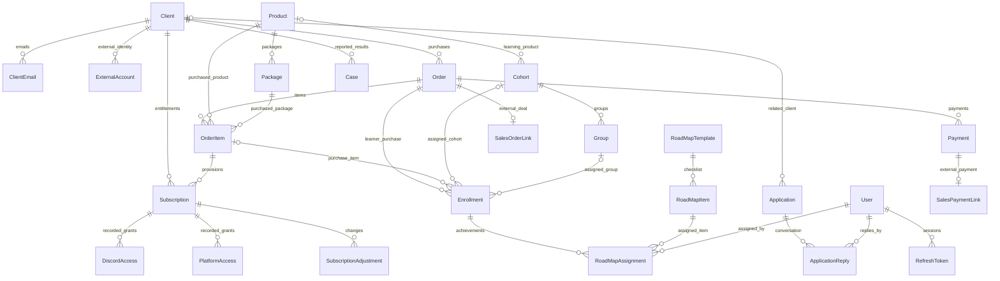

# Domain relationship map

This is a source-model overview, not a dump of a running database. See
ef-relationships.md for the guarded schema correction and migration limitations.

ULID identifies clients, orders/items/payments, users, learning structures,
subscriptions and team requests. Product/package/template/item IDs are integers.
Never join a user to Group.MentorId through a short display ID: MentorId is ULID?.

OrderItem is the purchase identity. ProductId cannot distinguish repeat purchases,
packages or multiple learning enrollments. Optional OrderItemId on Enrollment
exists for legacy rows; new manual enrollment requires the purchased item.

A first successful payment creates eligible subscriptions. Access activation starts
the configured duration. Cohort dates describe learning, independently of payment
and subscription dates. Managers assign groups manually; curators record roadmap
progress. Applications coordinate team work and audit captures resulting mutations.

For imports, Person ID belongs to Client.ExternalAccounts, Deal ID to SalesOrderLink
and external payment ID to SalesPaymentLink. SalesImportReceipt stores event replay
state. Profiles' initialBudget and totalEarnings are not external payment fields.
